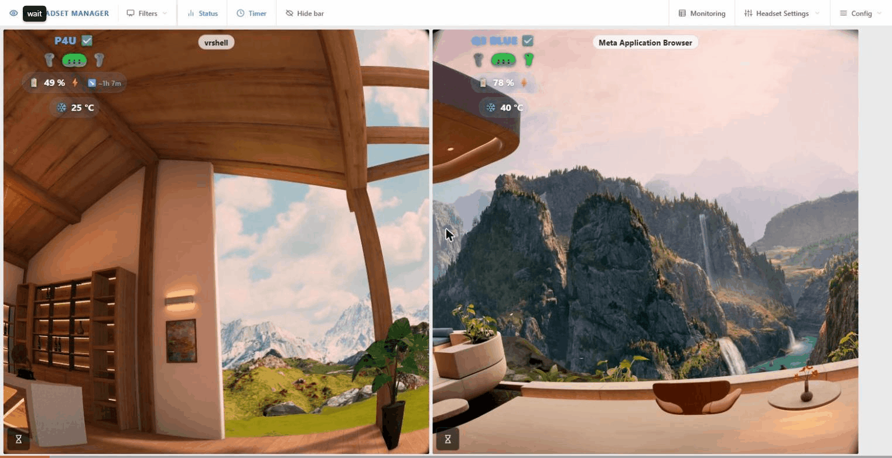

**Manage, monitor and screen-mirror a fleet of VR headsets — from one PC.**

---

**VR HEADSET MANAGER** (VRHM) is a Windows tool that manages, monitors and captures the screens of **Meta Quest** and **PICO** VR headsets over WiFi or USB, using **ADB** and [**scrcpy**](https://github.com/Genymobile/scrcpy).

It is built for **VR labs, showrooms, gaming events, training centres and any multi-headset setup** where an operator needs a live view of every headset — on a video wall, on lobby screens, or in **OBS**.

*The Video Monitor page: one tile per headset with live video, battery, controllers, temperature and session timer.*

*A quick tour of the web interface: Video Monitor, Monitoring (with battery history on hover), Headset Settings and Recordings.*

## Features

- **Live screen capture** of every headset, restreamed on the LAN as **WHEP (WebRTC), RTSP and HLS** through [MediaMTX](https://github.com/bluenviron/mediamtx), ready for browsers, VLC and OBS
- **Web interface** reachable from any device on the LAN, plus a full **console** on the server PC
- **Automatic capture**: streams start by themselves when a headset wakes up, and switch between USB and WiFi when you plug or unplug the cable
- **Easy onboarding**: plug a headset in once, VRHM enables WiFi ADB and registers it; headsets on the network are discovered automatically; a portable **toolbox** does the same from any other PC
- **Health monitoring**: headset and controller battery, charge power, CPU/GPU/skin temperatures, running app — with a history graph for each value and HTML overlays for OBS
- **DIAG page** per headset: firmware, health, WiFi, USB cable test, recovery actions and an ADB shell
- **Session timers** per headset, also driven by a [REST API](docs/timer-api.md) (Stream Deck, OBS, curl...)
- **Applications manager**: install, uninstall, update and launch apps remotely
- **Recording** of any capture, with a **Recordings page**: timeline, in-browser preview, download, lock and clean-up
- **Kiosk screens**: push a headset feed, a custom wall or any web page to lobby TVs and monitors
- **Eye merge**: both eyes of a Quest 3 stitched into one wider, level picture
- **Benchmark** and **Video Quality Automation** to size the capture settings to your PC

## Quick start

1. Download the [latest release](https://github.com/lyon-esport/VR_HEADSET_MANAGER/releases) and unzip it (keep `VR_HEADSET_MANAGER` in the folder name).
2. Run **`START_VR_HEADSET_MANAGER.exe`**. The first-run wizard sets the ports, downloads FFmpeg and configures the Windows Firewall (one admin prompt).
3. Open the web interface — the address is shown at the top of the console, by default **`http://<your-pc-ip>:8080`**.
4. Put your headset in **Developer Mode**, plug it in over USB and open **Headset Settings → Add New Headset**.
5. The capture starts on its own (auto-restart is on by default) — the headset appears on the **Video Monitor** page.

Full details: [Installation](docs/installation.md) → [Getting started](docs/getting-started.md).

## Documentation

**Using VRHM**

| Page | What you will find |
|---|---|
| [Installation](docs/installation.md) | Prerequisites, first-run wizard, updating, uninstalling |
| [Getting started](docs/getting-started.md) | From a fresh install to your first live stream |
| [Connecting headsets](docs/connecting-headsets.md) | USB onboarding, WiFi ADB (classic and TLS), USB-first transport, network discovery, the Headset Toolbox |
| [Web interface tour](docs/web-interface.md) | Every page of the web UI: Video Monitor, Monitoring, Headset Settings, DIAG, configuration |
| [Console](docs/console.md) | The console main screen, its shortcuts and the headset panel |
| [Streaming & OBS](docs/streaming.md) | Capture pipeline, profiles, eye merge, benchmark, stream URLs, OBS |
| [Recordings](docs/recordings.md) | Recording sessions, the Recordings page, preview, clean-up |
| [Applications manager](docs/apps-manager.md) | Launch, sideload, uninstall and update apps on headsets |
| [Kiosk screens](docs/kiosk-screens.md) | Drive lobby TVs and monitors: push URLs, cast headset feeds and walls |
| [Video Quality Automation](docs/vqa.md) | Automatic performance mitigation |
| [Troubleshooting](docs/troubleshooting.md) | Common problems and fixes |

**Reference**

| Page | What you will find |
|---|---|
| [Configuration reference](docs/configuration.md) | Every `config.json` setting, ports, WiFi credentials |
| [Timer API](docs/timer-api.md) | REST API for per-headset session timers |
| [VRHM ADB WiFi app](docs/android-adb-wifi.md) | Headset app that turns ADB over WiFi back on after reboots |

## Supported headsets

| Model | Status |
|---|---|
| Meta Quest 3 | Fully supported (per-eye crop profiles, eye merge) |
| Meta Quest 2 | Fully supported (crop profiles per lens position) |
| PICO 4 Ultra | Supported |
| Other Android-based headsets | Should work over WiFi ADB — profiles may need tuning |

> [!NOTE]
> Support for a new model is mostly a matter of adding a capture profile. Open a [GitHub issue](https://github.com/lyon-esport/VR_HEADSET_MANAGER/issues) if you need a new headset supported. *(And if you want to offer the author a headset, he will be pleased to support it in the next release! 😁)*

## Requirements at a glance

- Windows 10/11 PC on the same network as the headsets (Ethernet recommended for the PC)
- Headsets in **Developer Mode**
- Hardware: minimum 4 CPU cores, 16 GB RAM, 2 GB GPU VRAM for ~4 headsets — the built-in [benchmark](docs/streaming.md#benchmark-what-each-option-costs-this-pc) tells you what your PC can take

See [Installation](docs/installation.md) for the full list.

## License

Licensed under the **PolyForm Noncommercial License 1.0.0** — free for personal use and internal non-commercial business use; selling or commercial usage is not allowed. See [LICENSE](LICENSE.md).

## Credits

VR HEADSET MANAGER stands on the shoulders of:

- [scrcpy](https://github.com/Genymobile/scrcpy) — screen mirroring
- [MediaMTX](https://github.com/bluenviron/mediamtx) — real-time media server for restreaming
- [FFmpeg](https://ffmpeg.org/) — video re-encoding, eye merge and recording
- [SQLite](https://www.sqlite.org/) — local database
- [uPlot](https://github.com/leeoniya/uPlot) — history graphs
- [oculus-wireless-adb](https://github.com/thedroidgeek/oculus-wireless-adb) and ADB Auto Enable (`eu.project_simple.adbautoenable`) — keeping ADB over WiFi on after a reboot
- [MetaMetadata](https://github.com/threethan/MetaMetadata) — the database linking package names to app names and icons

Developer notes (design plans) live in [docs/dev/](docs/dev/).
