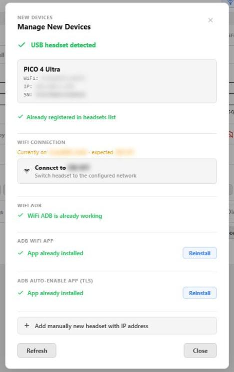

# Connecting headsets

[← Back to documentation home](../README.md#documentation)

VR HEADSET MANAGER talks to every headset with **ADB** (Android Debug Bridge). This page explains how headsets get connected, how VRHM keeps them connected, and the tools that help when you have many of them.

- [How VRHM reaches a headset](#how-vrhm-reaches-a-headset)
- [Onboarding over USB](#onboarding-over-usb)
- [Keeping WiFi ADB on after a reboot](#keeping-wifi-adb-on-after-a-reboot)
- [WiFi ADB modes: classic and TLS](#wifi-adb-modes-classic-and-tls)
- [USB first: capturing over the cable](#usb-first-capturing-over-the-cable)
- [Network discovery](#network-discovery)
- [IP address changes](#ip-address-changes)
- [The Headset Toolbox (onboarding from another PC)](#the-headset-toolbox-onboarding-from-another-pc)
- [Moving a headset to another WiFi network](#moving-a-headset-to-another-wifi-network)

## How VRHM reaches a headset

A headset is identified by its **serial number**, never by its IP address. VRHM can reach it in three ways, and the Monitoring and Headset Settings pages always show which one is in use:

| Link | Shown as | When |
|---|---|---|
| **USB** | `ADB USB` | The headset is cabled to the VRHM PC |
| **WiFi, classic** | `ADB WiFi` | The headset listens on a fixed port (`adb tcpip 5555`) |
| **WiFi, TLS** | `ADB WiFi (TLS)` | Android *Wireless debugging* is on; the headset advertises itself on the network |

All prerequisites: the headset is in **Developer Mode**, and the VRHM PC was authorized once (the *Allow USB debugging* prompt inside the headset, with *Always allow* ticked).

## Onboarding over USB

The simplest path, and the one that needs no typing:

1. Plug the headset into the VRHM PC and accept the debugging prompt inside the headset.
2. Open **Headset Settings → Add New Headset**.
3. The **Manage New Devices** dialog shows the headset (model, WiFi network, IP, serial) and checks each requirement: registered or not, connected to the expected WiFi, WiFi ADB working, helper apps installed. Each missing piece has its own button.

Once a headset is registered, **you never need this dialog again for it**: every time it is plugged into the VRHM PC, VRHM reads its serial number, re-enables WiFi ADB if needed and corrects its IP address — a few seconds, no click. In the console, **H** then **7** does the same for the cabled headset.

> [!NOTE]
> Re-enabling classic WiFi ADB (`adb tcpip`) briefly restarts the headset's ADB service, so the USB link drops for about 10 seconds. VRHM only does it when WiFi ADB is really off.

## Keeping WiFi ADB on after a reboot

Classic WiFi ADB is switched off by the headset at every reboot. Three ways to avoid plugging it in again:

| Option | How | Notes |
|---|---|---|
| **ADB auto-enable app (TLS)** — recommended | *Manage New Devices → ADB auto-enable app → Install* (console: **H** then **9**) | VRHM installs the app and grants it every permission it needs; Wireless debugging (TLS mode) then comes back on by itself at every boot. Meta Quest only (see below). |
| **ADB WiFi app** (oculus-wireless-adb) | *Manage New Devices → ADB WiFi app → Install* | Re-enables classic WiFi ADB from inside the headset. Meta Quest only. |
| **[VRHM ADB WiFi app](android-adb-wifi.md)** | Build/install from `android_adb_wifi/` | Our own app: classic WiFi ADB on launch or at headset startup. |

Without any of them, plugging the headset into the VRHM PC for a few seconds is enough.

## WiFi ADB modes: classic and TLS

VRHM supports both WiFi modes and uses whichever answers:

- **Classic** — the long-standing `adb tcpip` mode on a fixed port (`ADB.adbPort_default`, 5555). Fast to connect, but lost at every reboot unless a helper app turns it back on.
- **TLS (Wireless debugging)** — Android's encrypted mode. The port changes at every restart, so VRHM finds the headset by its **serial number** in the network announcements (mDNS) — no IP needed. With the ADB auto-enable app it survives reboots.

> [!NOTE]
> **PICO headsets cannot use TLS.** Their firmware lacks the *allow wireless debugging on this network* dialog, so Wireless debugging switches itself off within a second. VRHM knows it: a PICO always stays on classic WiFi ADB, is never switched to TLS, and the ADB auto-enable app is refused on it. After a reboot, plug a PICO in over USB for a few seconds to bring WiFi ADB back.

Three settings in **App Configuration → ADB** (or console **C → A**) control them:

| Setting | Default | Meaning |
|---|---|---|
| `wifi_classic_enabled` | `true` | Use classic WiFi ADB |
| `wifi_tls_enabled` | `true` | Use TLS WiFi ADB |
| `wifi_preferred_mode` | `auto` | `auto` = use whatever answers and never switch; `classic` or `tls` = VRHM moves headsets to that mode when they are on the other one |

With a preferred mode, the switch is gentle: moving to TLS interrupts nothing; moving to classic restarts the headset's ADB service, so a running capture is only moved according to `scrcpy.usb_switch_mode` (by default when it is not recording). After three failed attempts in a row VRHM stops trying for that headset (one warning in the log) until the preference changes, the headset drops off WiFi ADB and comes back, or the application restarts; the DIAG page shows the mode in use and the switch state. Changes apply within one monitoring cycle, no restart.

## USB first: capturing over the cable

When a registered headset is cabled to the VRHM PC, VRHM prefers USB for every command and for the capture itself (`ADB.prefer_usb`, on by default): more bandwidth, no WiFi load. If the cable is pulled in the middle of a command, the command is retried over WiFi at once.

For a capture that is **already running over WiFi** when you plug the cable in, `scrcpy.usb_switch_mode` decides:

| Value | Behaviour |
|---|---|
| `stable` (default) | Switch to USB once the cable has been in for `usb_switch_stable_sec` (10 s) and the headset is not recording |
| `immediate` | Switch at once, even while recording |
| `next_start` | Never interrupt; USB is used for the next capture |

A capture running over USB whose cable is pulled restarts over WiFi immediately.

## Network discovery

VRHM sweeps the PC's network every 60 seconds (`VRMonitor.networkDiscovery`) for headsets that answer ADB — classic port scan and TLS announcements. An unknown headset is never added by itself; it is **proposed**:

- **Headset Settings** shows a blinking **Discovered devices** button. Open it, then **Add** (give it a name) or **Forget**.
- In the console, the **D** tile appears on the main screen when devices are waiting.

*Forget* is permanent and tied to the **serial number**, so the headset stays forgotten when its IP changes. Adding it manually later (USB, IP, toolbox) clears that.

Discovery also keeps known headsets up to date: a known serial found at a new address gets its IP corrected.

## IP address changes

Because headsets are identified by serial number, a DHCP change heals itself:

- plugging the headset in over USB, network discovery, the TLS announcements and the VRHM Companion app all correct the IP automatically;
- if two headsets swap addresses, both are corrected within a couple of monitoring cycles;
- you can still edit the IP by hand on the headset card (pencil icon).

A headset whose address was taken by another one shows **IP unknown** until it is seen again.

## The Headset Toolbox (onboarding from another PC)

`VRHM-Headset-Toolbox.exe` is a single portable file for **any PC other than the VRHM server** — a technician's laptop at a charging station, for example. Download it from **Add New Headset** or from the **Kiosk Screens** page (*Download kiosk launcher*).

On start it finds the VRHM server on the network by itself (or asks you to pick one, or to type `ip`, `ip:port` or a URL), then offers:

| Option | What it does |
|---|---|
| `[1]` Headset Toolbox | Waits for a headset on USB, enables WiFi ADB and registers it with the server (a known headset just has its IP corrected). Then offers to move it to one of the server's WiFi networks or to install the wireless ADB app. Unplug it and the next one can be plugged in — no keyboard needed. |
| `[2]` Kiosk Agent | Turns that PC into a managed kiosk screen — see [Kiosk screens](kiosk-screens.md). |
| `[3]` Change VRHM server | Search again, or type an address. |

`adb.exe` is not inside the toolbox: it is downloaded from the server on first use, so it always matches the server's version. WiFi passwords never go through the toolbox — the server pushes the network itself.

Command line: `-toolbox` (straight to the headset toolbox), `-kiosk` (straight to the kiosk agent), `-autodiscover`, `-vrhm_ip <ip|ip:port|url>`, `-vrhm_port <n>`. The full operator guide is [`website/headset-toolbox/README-Toolbox.md`](../website/headset-toolbox/README-Toolbox.md) (also written next to the exe as `VRHM-Toolbox\HOWTO.txt`).

## Moving a headset to another WiFi network

From the web interface, three places do it, all over the server's own ADB connection (the password never leaves the server):

- **Manage New Devices → Connect to <network>** for a cabled headset,
- the **DIAG** page's *WiFi networks* card (scan from the headset's own radio, switch, or connect to a new network) — see [Web interface → Headset DIAG](web-interface.md#headset-diag),
- the toolbox's per-headset menu, and the console headset panel (key **9**).

VRHM first asks the **headset** which networks it can see, and refuses to push one it cannot reach (a 6 GHz-only network on an older headset, typically), because that would strand the headset off the network.

The WiFi networks VRHM knows are stored encrypted on the server (**App Configuration → WiFi Networks**, or console **C → W**).
