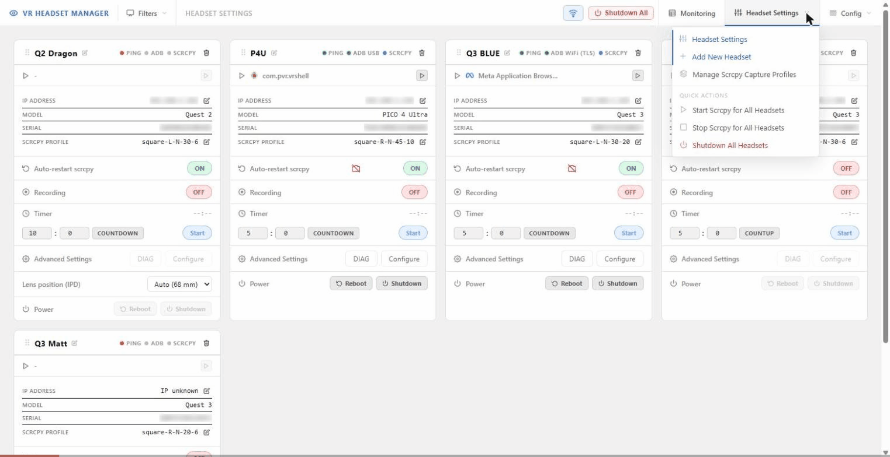
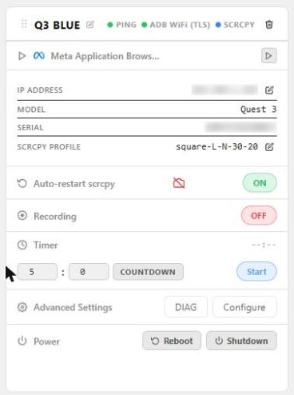
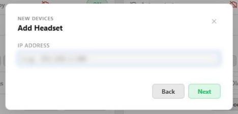
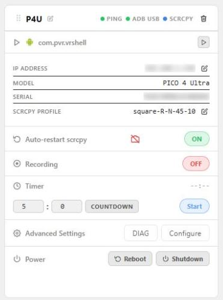

# Getting started

[← Back to documentation home](../README.md#documentation)

This guide takes you from a freshly installed VR HEADSET MANAGER to a live headset stream, using the web interface. Everything shown here can also be done from the [console](console.md).

## 1. Open the web interface

Start the application with `START_VR_HEADSET_MANAGER.exe` if it is not already running (by default it also opens the web interface in your browser). The address is shown in the status banner of the console — by default:

```
http://<your-pc-ip>:8080
```

Open it in any browser on the LAN. The top bar gives you access to every page:

- **Video Monitor** (home) — live wall of all headset streams
- **Monitoring** — status table (battery, temperatures, connectivity, running app) and PC statistics
- **Headset Settings** — one card per headset: capture, recording, timer, DIAG, power. Its drop-down menu holds **Add New Headset** and the actions for all headsets
- **Config** menu — every other page: Kiosk Screens, Recordings, Headsets Apps, Known Apps, Help & Diagnostics, Benchmark, App Configuration and the dark mode

## 2. Add your first headset

> [!IMPORTANT]
> The headset must already be in **Developer Mode**. On a Meta Quest, follow the [official Meta tutorial](https://developers.meta.com/horizon/documentation/native/android/mobile-device-setup/); on a PICO, enable the developer options from *Settings → General → About* (tap the software version several times) and turn on USB debugging.

### Option A — USB (recommended)

1. Connect the headset to the VRHM PC with a USB cable.
2. Put the headset on and **accept the "Allow USB debugging" prompt** (tick *Always allow from this computer*).
3. Open **Headset Settings → Add New Headset** (on a fresh install the page also shows a big **"Click here to add your first headset"** button).
4. The **Manage New Devices** dialog detects the headset and shows its model, WiFi network, IP address and serial number. Click **Add this headset to the list**: VRHM reads the model and serial number, **enables ADB over WiFi**, and registers the headset under a friendly name.



The same dialog checks everything the headset needs and offers a button for each missing piece:


- **WiFi connection** — moves the headset onto the WiFi network configured on the server (the password never leaves the server)
- **WiFi ADB** — enables ADB over WiFi now
- **ADB WiFi app** / **ADB auto-enable app (TLS)** — small headset apps that turn wireless ADB back on after every reboot, so you do not need the cable again. See [Connecting headsets](connecting-headsets.md#keeping-wifi-adb-on-after-a-reboot).

Once added, the headset gets its own card in **Headset Settings**:



> [!TIP]
> A headset VRHM already knows is handled by itself whenever you plug it in: WiFi ADB is re-enabled and its IP address corrected after a few seconds. While the cable is in, VRHM even uses USB for the capture and switches back to WiFi when you unplug it. See [Connecting headsets](connecting-headsets.md).

### Option B — manually by IP address

If the headset already has ADB over WiFi enabled, you can skip the cable: in **Manage New Devices** click **Add manually new headset with IP address**, enter the IP and then a name.



> [!NOTE]
> The first time VRHM connects over ADB, the headset asks you (inside VR) to authorize the computer. Tick *Always allow from this computer* and accept.

### Option C — let VRHM find it

Headsets with WiFi ADB enabled that are on the same network are **discovered automatically** (every 60 s by default). When one is found, a blinking **Discovered devices** button appears on **Headset Settings**: add it with a name, or *Forget* it. See [Connecting headsets → Network discovery](connecting-headsets.md#network-discovery).

## 3. Watch the stream

**Auto-restart scrcpy** is **ON** by default on every new headset: as soon as the headset is reachable, VRHM starts its capture by itself. Go to the **Video Monitor** page (the home page) — after a few seconds the live video appears on the headset's tile. While a capture starts, the tile shows *Capture starting...*.


If auto-restart is off, click the **stream button** on the tile, or switch **Auto-restart scrcpy** to **ON** on the headset's card:



From then on the capture comes back automatically whenever the headset wakes up, reconnects or reboots — as long as ADB over WiFi is still enabled (see [Connecting headsets](connecting-headsets.md#keeping-wifi-adb-on-after-a-reboot) to keep it on across reboots).

> [!NOTE]
> By default VRHM only streams (`StreamOnly` capture mode). Switch to `StreamAndLocalWindow` in **App Configuration → Streaming** if you also want a scrcpy mirror window on the VRHM PC. See [Streaming → Capture modes](streaming.md#capture-modes).

## 4. Check headset health

Open the **Monitoring** page to see everything at a glance: ping/ADB/scrcpy status (with the link in use: USB, WiFi or WiFi TLS), charge state and power draw, battery levels (headset and both controllers), temperatures, model, and the app currently running in the headset. Hover a battery or temperature cell for a one-hour sparkline, click it for the full history.


## Where to go next

- Put the streams into **OBS** or on the LAN → [Streaming & OBS](streaming.md)
- Record sessions → [Recordings](recordings.md)
- Show headsets on lobby TVs → [Kiosk screens](kiosk-screens.md)
- Launch or install games remotely → [Applications manager](apps-manager.md)
- Limit session time per player → [Timer API](timer-api.md) (timers are also on each Video Monitor tile and Headset Settings card)
- Diagnose a headset → [Web interface → Headset DIAG](web-interface.md#headset-diag)
- Tune everything → [Configuration reference](configuration.md)
