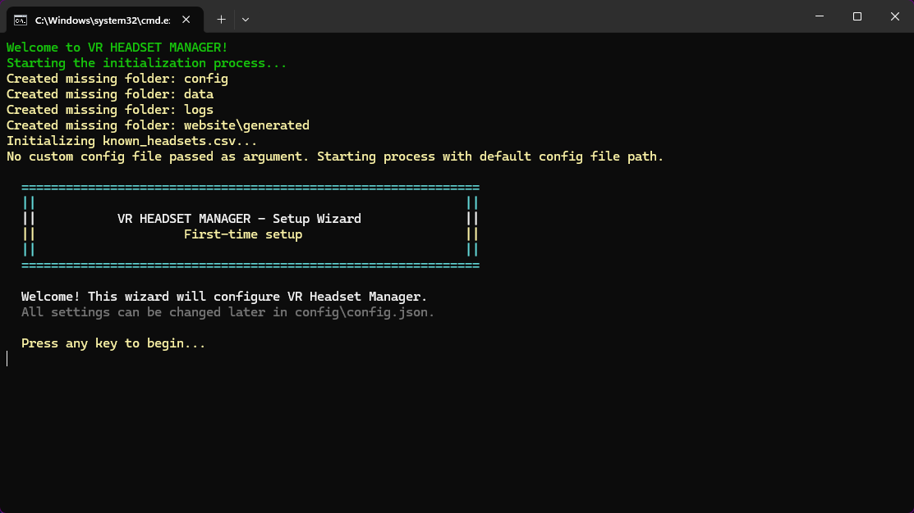
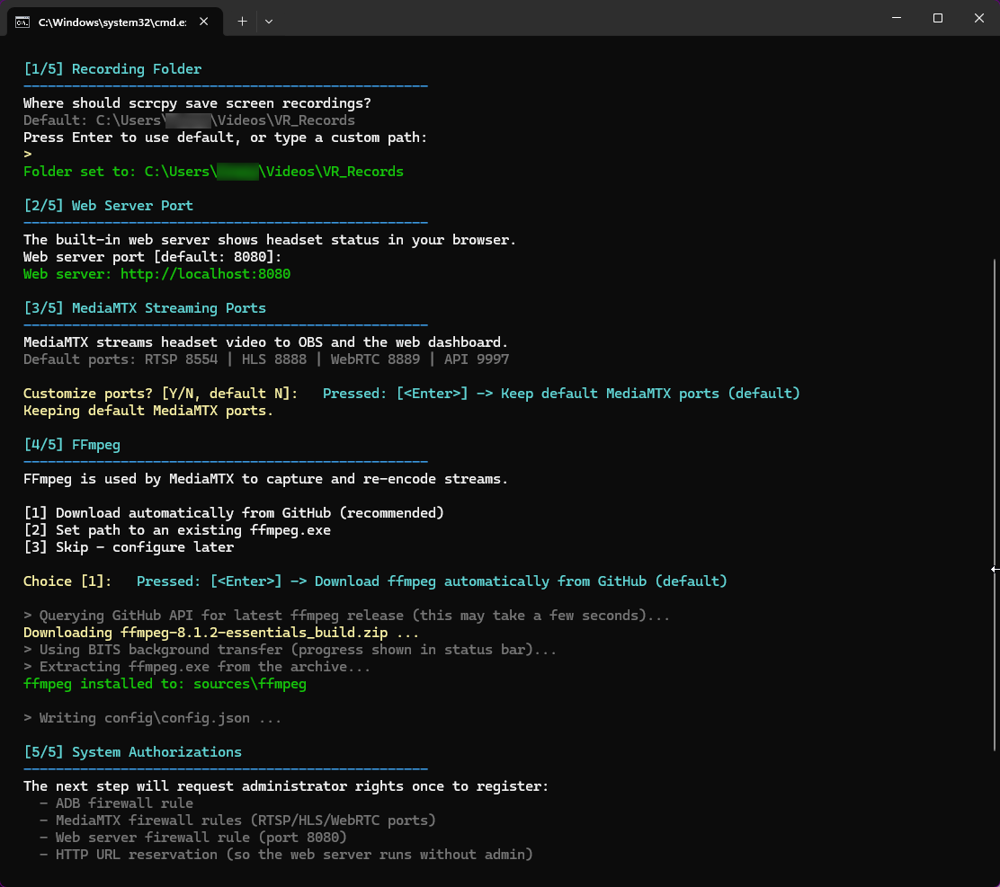
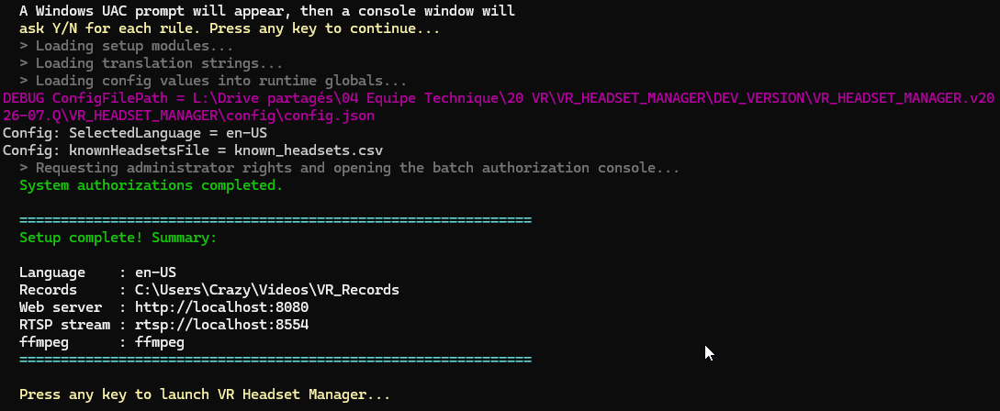

# Installation

[← Back to documentation home](../README.md#documentation)

## Prerequisites

### Computer

- **Windows 10 or 11**
- Windows PowerShell 5.1 (built into Windows — nothing to install)
- The unzipped folder name must contain **`VR_HEADSET_MANAGER`** (the launcher checks this)
- Connected to the **same network** as the headsets — a **wired Ethernet connection is strongly recommended** for the PC

### Hardware sizing

Streaming VR headsets is demanding. As a baseline for **4 headsets**:

| Resource | Minimum |
|---|---|
| CPU | 4 cores |
| RAM | 16 GB |
| GPU | 2 GB dedicated VRAM |

The more headsets you capture — and the more viewers watch the restreams — the more resources you need. If the PC gets overloaded, [Video Quality Automation](vqa.md) can recommend or automatically apply resolution and bitrate reductions.

### Network

> [!TIP]
> To keep latency low, dedicate a WiFi SSID (and ideally a radio channel) to the headsets only, and connect the VRHM computer over Ethernet.

### Headsets

- The headset must be in **Developer Mode** ([official Meta tutorial](https://developers.meta.com/horizon/documentation/native/android/mobile-device-setup/))
- **ADB over WiFi** must be reachable — VRHM enables it automatically when you plug a headset in over USB, and can install a small app that keeps it on after reboots: see [Connecting headsets](connecting-headsets.md)
- The headset must be connected to WiFi and reachable from the PC (a headset cabled to the VRHM PC also works over USB)

> [!IMPORTANT]
> Without these prerequisites the headset is not reachable over the network, and screen capture will not work.

## Install and first run

1. **Download** the [latest release](https://github.com/lyon-esport/VR_HEADSET_MANAGER/releases) and **unzip** it anywhere on your machine (keep `VR_HEADSET_MANAGER` in the folder name).

2. **Run `START_VR_HEADSET_MANAGER.exe`** (double-click). It starts PowerShell with the correct execution policy and launches the manager. On first start, the **Setup Wizard** welcomes you:

   

   > **Setup prompts (firewall, URL reservation, Defender):** press `Y`/Enter to approve one box, `A` to approve it and all the following ones, any other key to skip. To approve everything without a keypress, start the program with the `-AutoApprove` option, e.g. a shortcut whose target is `START_VR_HEADSET_MANAGER.exe -AutoApprove`. Boxes that would kill a process always ask.

3. **Follow the Setup Wizard.** It walks you through 5 quick steps (every choice can be changed later in `config\config.json` or from the web interface):

   1. **Recording folder** — where scrcpy saves screen recordings
   2. **Web server port** — default `8080`
   3. **MediaMTX streaming ports** — defaults RTSP `8554` / HLS `8888` / WebRTC `8889` / API `9997`
   4. **FFmpeg** — downloaded automatically from GitHub (recommended), or point to an existing `ffmpeg.exe`
   5. **System authorizations** — ⚠️ a **User Account Control (admin) prompt appears once** to register:
      - Windows Firewall rules so `adb.exe` can talk to the headsets
      - Windows Firewall rules so MediaMTX can restream on the network
      - Windows Firewall rule for the web server, plus the HTTP URL reservation (so the web server runs without admin)

   

   You may also be asked whether you want to **exclude the application folder from Windows Defender**. This is optional but recommended: real-time scanning of the video pipeline can cause high CPU usage.

   The wizard ends with a summary and launches the manager:

   

4. **Open the web interface.** The web server starts automatically; its address is shown in the status banner at the top of the [console](console.md) (press `F1` for the full list of addresses, or `W` to open it in your browser) — by default:

   ```
   http://<your-pc-ip>:8080
   ```

   You can open it from the VRHM PC itself or from any device on the same LAN (some management features, like installing APK files, are only available when browsing from the VRHM PC itself).

5. Continue with [Getting started](getting-started.md) to add your first headset.

> [!NOTE]
> If a program VRHM needs (scrcpy/adb, MediaMTX, FFmpeg) is missing at startup, the console offers to **download the latest version** or to **point to an existing folder** instead of stopping. Each of them can also be updated, or rolled back to an older installed version, from **Config → App Configuration → Advanced**; the change applies at the next application restart.

## Updating

1. Quit VR HEADSET MANAGER (`0` in the console, or **Config → Help & Diagnostics → Shutdown Application** in the web UI).
2. Unzip the new release into a **new folder**.
3. Copy your personal data from the old folder if you want to keep it:
   - `config\config.json` — your configuration
   - `data\` — the local database `vrhm.db` (headset registry, kiosks, live status, app catalogue, timers, metric history, recordings catalogue) and the encrypted WiFi store `wifi_networks.dat`

   Quit the old version before copying `data\`, so the database is complete on disk.
4. Start the new version.

## Uninstalling

VRHM does not install anything system-wide except the firewall rules and the URL reservation it created on first run. To remove it completely:

1. Delete the application folder.
2. Optionally remove the firewall rules: search for rules containing `VR_HEADSET_MANAGER` in **Windows Defender Firewall → Advanced Settings → Inbound Rules**.
3. Optionally remove the Windows Defender exclusion (**Windows Security → Virus & threat protection → Exclusions**) if you accepted it during setup.

---

Next: [Getting started →](getting-started.md)
