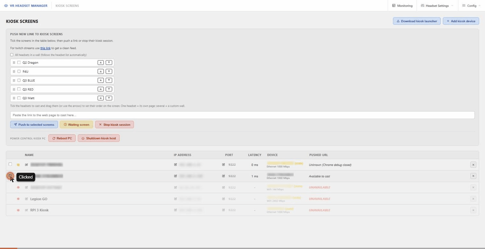
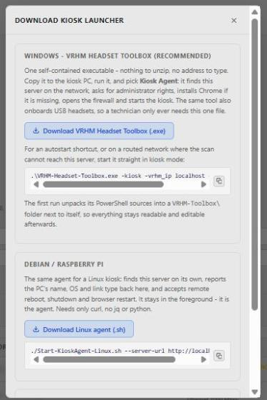
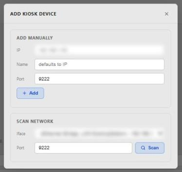
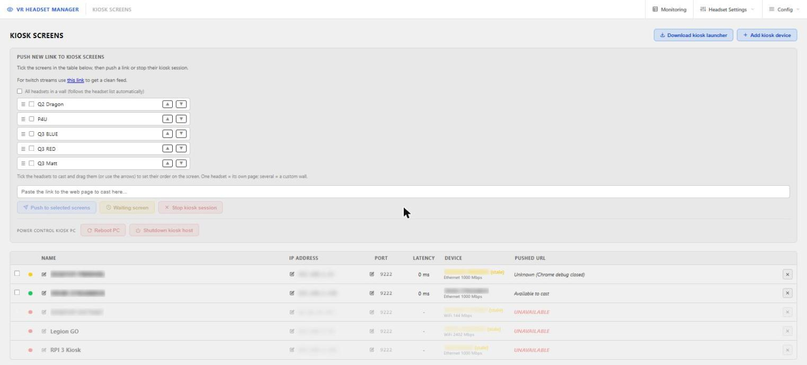

# Kiosk Screens

[← Back to documentation home](../README.md#documentation)

**Kiosk Screens** lets you remote-control any PC that displays a browser full screen — a lobby TV, a showroom monitor, a second display at a booth — from VR HEADSET MANAGER: push a URL to it, cast one headset's live video or a custom wall of several headsets, stop its kiosk session, or reboot / shut the PC down. It reuses the [Video Monitor](web-interface.md#video-monitor-home-page) streams, so it works as a lightweight "cast to a wall display" feature.



## How it works

1. A **kiosk agent** runs on the display PC (Windows or Linux). It opens Chrome/Chromium full screen with its remote debugging protocol (CDP) enabled on a port (default `9222`).
2. The agent finds the VRHM server on the network by itself and reports to it every few seconds (PC name, OS, Ethernet or WiFi, link speed, browser version). A kiosk that reports for the first time is **added automatically**.
3. From the **Kiosk Screens** page (or the console **K** tile) you push a URL or a headset feed: VRHM sends `Page.navigate` over CDP and the screen switches instantly, with nobody touching the kiosk PC.
4. Operator commands (reboot, shutdown, restart the browser, stop the agent) travel back inside the agent's heartbeat reply — the agent never opens a listening port of its own.

## 1. Set up the kiosk PC

### Windows — VRHM Headset Toolbox (recommended)

1. On the **Kiosk Screens** page, click **Download kiosk launcher**, then **Download VRHM Headset Toolbox (.exe)**.
2. Copy `VRHM-Headset-Toolbox.exe` to the kiosk PC and run it. It finds the VRHM server (or asks you to pick one / type `ip:port`).
3. Choose **`[2]` Kiosk Agent**. It restarts elevated (one UAC prompt), installs Chrome silently when missing, opens the firewall for the DevTools port and ping, starts Chrome in kiosk mode and starts reporting.



**Start it at every logon:** each run of the exe writes `VRHM-Toolbox\VRHM Kiosk Agent.lnk` next to it (it starts the exe with `-kiosk`). Copy it into the Startup folder (`Win+R` → `shell:startup`). Add `-vrhm_ip <ip> -vrhm_port <port>` to the shortcut target to skip the server search. To avoid the UAC prompt at each logon, use a scheduled task instead (elevated prompt):

```
schtasks /Create /TN "VRHM Kiosk Agent" /SC ONLOGON /RL HIGHEST /TR "\"C:\VRHM\VRHM-Headset-Toolbox.exe\" -kiosk"
```

The same exe also onboards headsets from that PC — see [Connecting headsets → Headset Toolbox](connecting-headsets.md#the-headset-toolbox-onboarding-from-another-pc). Full operator guide: [`README-Toolbox.md`](../website/headset-toolbox/README-Toolbox.md).

### Linux (Debian / Raspberry Pi OS)

Download **Linux agent (.sh)** from the same panel and run it in the kiosk's graphical session — same protocol, only `curl` needed:

```bash
chmod +x Start-KioskAgent-Linux.sh
./Start-KioskAgent-Linux.sh --server-url http://<vrhm-ip>:8080
```

### Basic launchers (fallback)

`Start-KioskChrome.ps1` (Windows) and `Start-KioskChrome-Linux.sh` only open Chrome in kiosk mode with CDP enabled: URL casting works, but there is no reporting and no remote reboot/shutdown. Use them only when the toolbox cannot run on that PC.

> [!WARNING]
> The Chrome DevTools Protocol gives full control of the kiosk browser. Only use it on a trusted lab/showroom LAN, never on public WiFi or an internet-routed network.

## 2. Register the kiosk in VRHM

A kiosk running the agent adds itself. Otherwise, use **Add kiosk device**:

- **Add manually** — the kiosk's IP, an optional name (defaults to the IP) and its debug port (default `9222`)
- **Scan network** — pick a local network interface, scan its subnet for open CDP ports and add the ones found



A kiosk you remove is not re-added by its agent's next heartbeat; adding it manually again works.

## 3. Push a URL or a headset feed



The table lists every kiosk: status dot, name, IP and port (editable with the pencil), latency, device (PC name, Ethernet/WiFi and link speed, `stale` when its agent stopped reporting) and what is on screen now (*Available to cast*, the pushed URL, or *UNAVAILABLE*). The **×** button removes a kiosk.

Tick one or more screens in the table, then in the **Push new link to kiosk screens** panel:

- **Cast headsets** — tick the headsets to show and order them with the arrows or by drag-and-drop. One headset = its own video page; several = a **custom wall** with only those headsets, in that order (offline ones are hidden). **All headsets in a wall** follows the headset list automatically. **Display monitor + timer overlay** (on by default) keeps the battery/controller/timer HUD; untick it for a clean video. The generated link is shown with a **Copy link** button.
- **Or paste any URL** in the box (a YouTube link also shows a subtitles option).
- **Push to selected screens** sends it; **Waiting screen** shows a neutral "Ready to stream" page; **Stop kiosk session** closes the browser (and stops the agent so its watchdog does not reopen it).
- **Power control kiosk PC** — **Reboot PC** / **Shutdown kiosk host** (agent kiosks only). The kiosk always shows a one-minute warning on screen first.


If a URL points at `localhost` / `127.0.0.1`, VRHM notices it would resolve to the kiosk PC itself and offers to replace it with the server's LAN address before pushing.

The **cast** button on a Video Monitor tile, and on a headset's `[video].html` page, opens a *Cast to kiosk screen* popover pre-filled with that headset's feed.

### Wall URLs

The pushed wall is the Video Monitor page with its top bar hidden, so it can also be bookmarked or opened by hand:

| URL | Shows |
|---|---|
| `http://<pc-ip>:8080/?hidetopbar=1` | Every live headset |
| `http://<pc-ip>:8080/?hidetopbar=1&filterid=10,9` | Only headsets 10 and 9, in that order |
| `...&nooverlay=1` | The same, without the status/timer overlays |

## Console equivalent

The console **K** tile does the same without a browser: list kiosks with live status, `[A]` add manually, `[S]` scan network, then select a row by number for `[P]` push a URL (or `W` for a headset wall), `[E]` edit, `[I]` device info, `[R]` reboot, `[H]` shutdown, or `[D]` delete. See [Console](console.md).

## Logs and troubleshooting

Kiosk actions are logged in `logs\<COMPUTERNAME>\kiosk_<date>.log`: add/edit/remove, scans, pushes, power commands, and agent state changes.

- **The kiosk shows "UNAVAILABLE" or "Chrome debug closed".** Recent Chrome builds only bind DevTools to `127.0.0.1`; the agent then sets up a `netsh portproxy` forward, which needs the **IP Helper** service (`iphlpsvc`). Check with `Get-Service iphlpsvc` and `Get-NetTCPConnection -LocalPort 9222` on the kiosk.
- **"No VR HEADSET MANAGER server was found"** on the kiosk: the scan only covers the kiosk's own networks — type the server address (`ip:port`) in the toolbox.
- **Chrome shows "Restore pages?"**: delete `%LOCALAPPDATA%\VRHM_KioskChrome` on the kiosk.

More in [`README-Toolbox.md`](../website/headset-toolbox/README-Toolbox.md#troubleshooting) and the general [Troubleshooting](troubleshooting.md) page.
