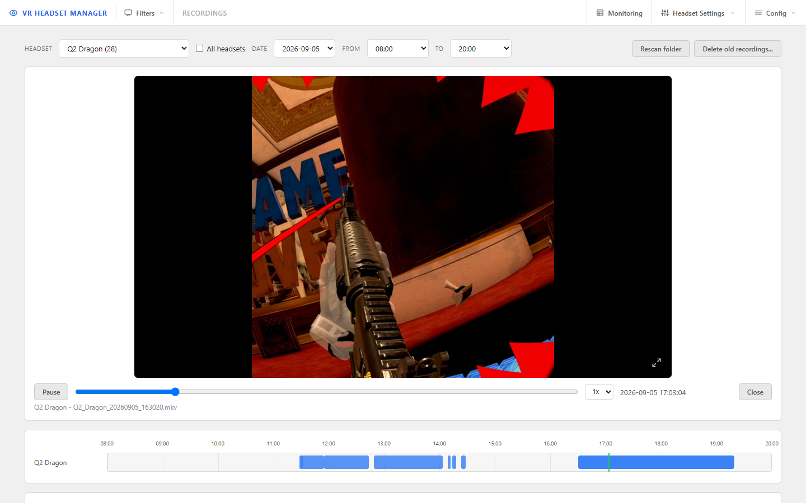
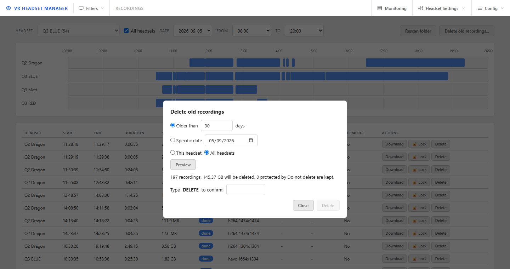

# Recordings

[← Back to documentation home](../README.md#documentation)

VR HEADSET MANAGER can record every capture session to disk, and the **Recordings** page lets you find, watch, download, protect and clean up those recordings from any browser.

## Turning recording on

Recording is a per-headset switch. Turn it on or off from:

- the **Recording** toggle on the headset's card in **Headset Settings**;
- the **camera button** in the hover actions of a tile on the Video Monitor page, or of the single-headset `[video].html` page (red camera = recording);
- the console: `<id>r` on the main screen, the **R** tile, or key **4** of the headset panel.

Switching it restarts the capture so the new session is recorded (or not) from the first frame.

## What gets recorded

- **Lossless copy of the capture.** The file holds exactly what the headset sent (no re-encoding, whatever the restream settings), or the merged picture for an [eye merge](streaming.md#merged-view-both-eyes-in-one-picture-eye-m) view.
- **One file per capture session.** Unplugging a cable or restarting a capture starts a new timestamped `.mkv`; the previous one is finalised when its session ends. Matroska is used on purpose: the file stays readable even if a capture is cut abruptly.
- **Folder layout:** `<record folder>\<yyyy-MM-dd>\<headset>\<headset>_<yyyyMMddHHmmss>.mkv`. The record folder is set in **App Configuration → Recordings** (`scrcpy.recordFolder`, default `C:\DATA\MEDIA\VR_Records`).
- **Free-space guard.** When the recording drive has less than `recordMinFreeSpaceGB` (default 5 GB) free, recording is refused and switched off on every headset; the web UI shows a storage warning.
- **No empty files.** A capture attempt that never produced video leaves no 0-byte file behind; files under 64 KB are kept but reported in the log.
- **Interrupted recordings are repaired.** A session cut abruptly (application or PC stopped, capture killed) is marked *interrupted*; VRHM repairs the file in the background (a quick stream copy that rebuilds its index and real duration) and marks it done. The original is only replaced when the repair succeeded.

## The Recordings page

Open **Config → Recordings**.

- **Filters** — a headset, a date (only days that hold recordings are listed) and an hour range. **All headsets** shows one timeline lane per headset. The filters are kept in the page address, so a view can be bookmarked or shared.
- **Timeline** — one bar per recorded session. Blue = finished, red pulsing = still recording, amber = interrupted. A lock marks a protected recording. Click a point of a bar to play from that exact moment; click a gap to jump to the next recording.
- **List** — start, end, duration, size, status, codec and picture size, capture profile (view / eye / fps / bitrate), capture mode and eye merge. **Click a row to play it.** Each row also has:
  - **Download** — the original `.mkv`, byte for byte;
  - **Lock / Locked** — "do not delete": a locked recording can be neither deleted nor wiped. You can add a short note when locking it (shown as a tooltip);
  - **Delete** — removes the file and its entry after a confirmation. Not available on a locked recording or one still being recorded.
- **Rescan folder** re-reads the record folder now (the app also does it at every start and every 10 minutes): files copied in by hand appear, files deleted outside the app disappear. If the folder cannot be reached (drive unplugged), nothing is removed.

### Watching a recording

The browser cannot play the recorded `.mkv` directly, so the server re-encodes it **live** into a lighter h264 stream (720p, 30 fps by default) and plays it with the same low-latency technology as the Video Monitor. The recording files themselves are never touched.

- **Play / Pause**, the **Space** key, or a **single click on the picture** toggle playback. While paused, the last image stays on screen.
- **Double-click the picture**, or the button in its bottom-right corner, for full screen.
- Drag the **seek bar**, or click the timeline, to jump; **1x / 2x / 4x** sets the speed. The clock shows the real date and time of the image on screen, and the green line follows it on the timeline.
- At the end of a recording the next one of the same headset starts automatically.

The preview needs MediaMTX running in a streaming capture mode; in **LocalWindow** mode the page says so and the list, timeline and downloads still work. At most 2 previews run at once (configurable), and a preview stops by itself about 30 s after its browser tab is closed. Preview settings are in **App Configuration → Recordings** ([reference](configuration.md#recordings)).

> [!NOTE]
> The preview shows exactly what was recorded. A recording made while the headset was asleep is black, and a recording made at 10 fps stays at 10 fps — the preview cannot add frames.

### Deleting old recordings

**Delete old recordings...** frees disk space in bulk: recordings **older than N days**, or all recordings of **one date**, for the selected headset or all of them. **Preview** first shows how many recordings and how much space would go and how many are kept because they are locked; the **Delete** button only unlocks after you type `DELETE`. Locked recordings, sessions still recording and files written in the last minute are never deleted, and empty date/headset folders are removed afterwards.

## Behind the page

Every session is listed in the application's database with its start and end time, size, codec, picture size and the capture settings it was made with. The file on disk stays the source of truth: at every start, and every `Recordings.rescan_interval_min` minutes (default 10), the catalogue is reconciled with the folder — new files are imported, entries of deleted files are dropped, and sessions a crash left open are closed as *interrupted*.

The Recordings page is web-only; the console offers recording on/off per headset.

---

Related: [Streaming & OBS](streaming.md) · [Configuration → Recordings](configuration.md#recordings) · [Troubleshooting](troubleshooting.md#recording-refuses-to-enable--stopped-by-itself)
