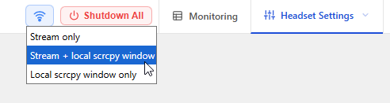
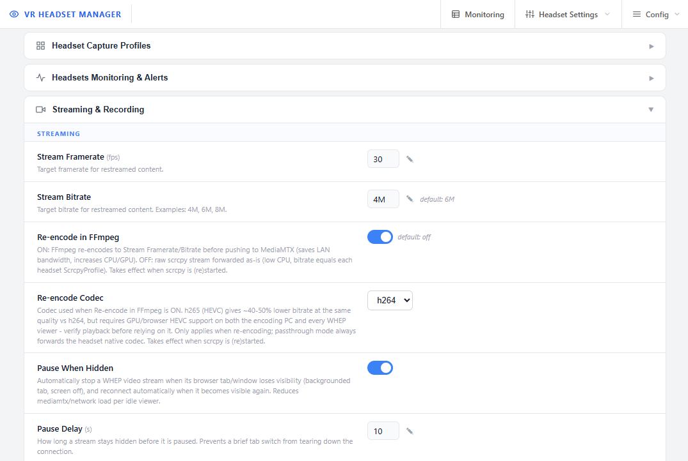
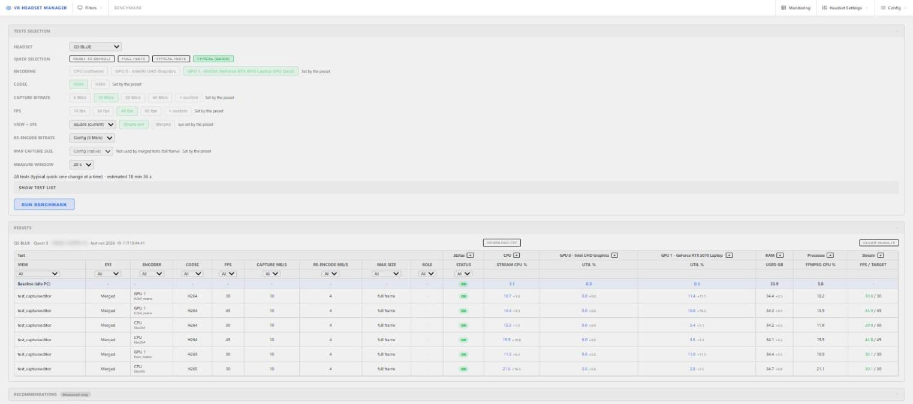
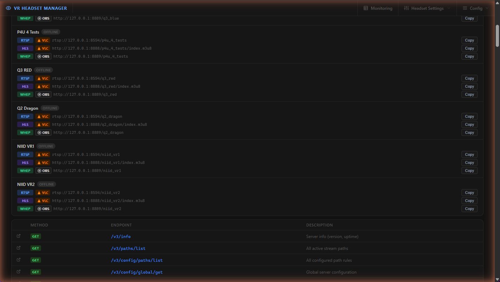
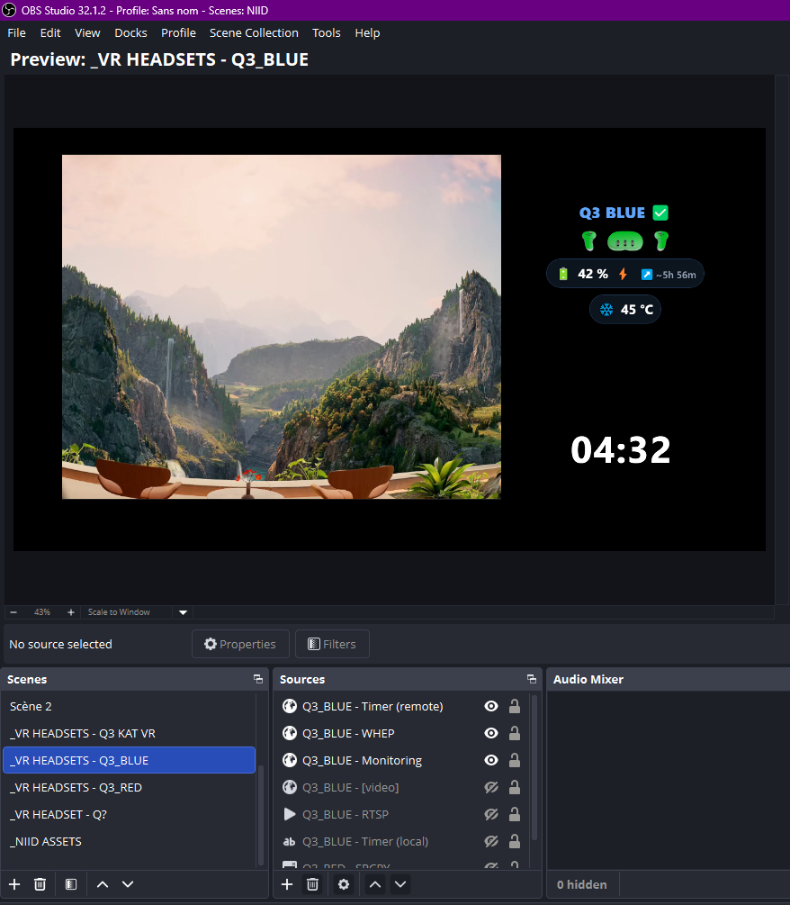
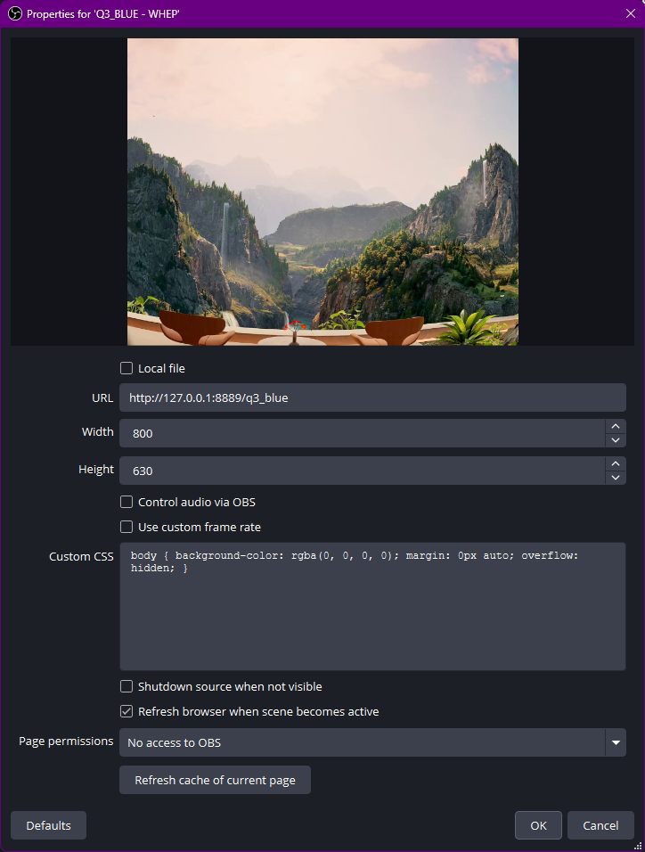
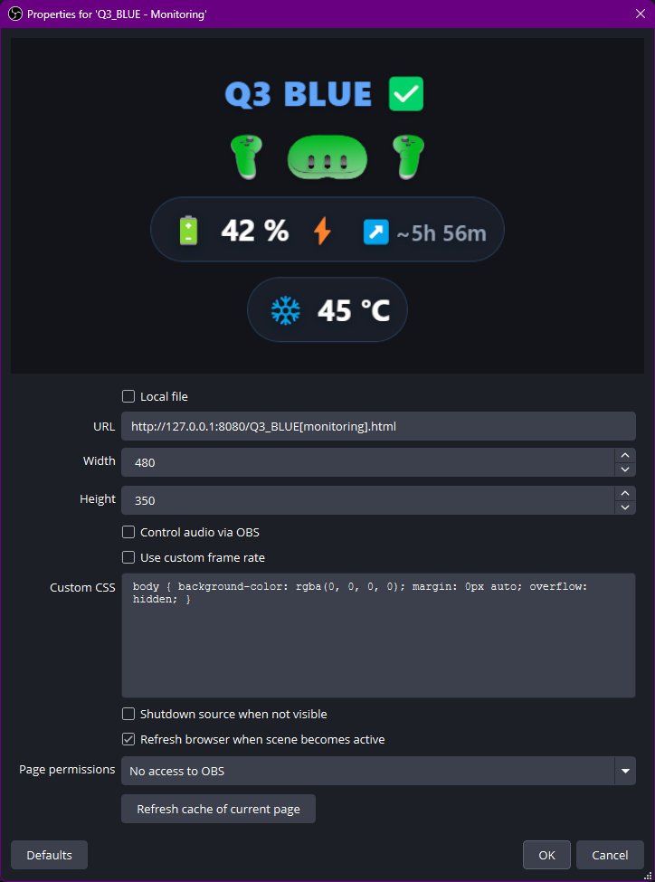
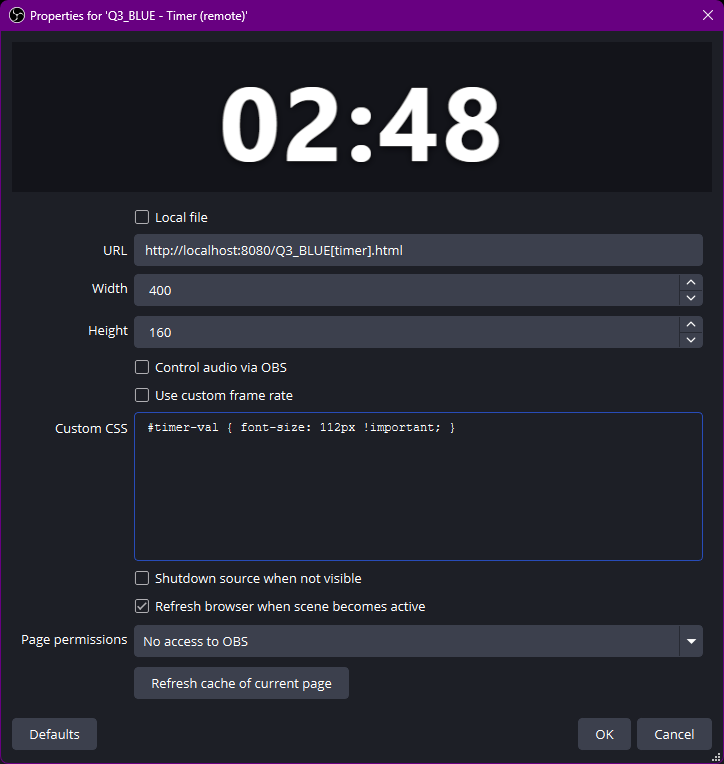

# Streaming, restreaming & OBS

[← Back to documentation home](../README.md#documentation)

## How the pipeline works

```
┌──────────┐  WiFi ADB   ┌────────┐        ┌────────┐  RTSP   ┌──────────┐  RTSP / HLS / WHEP
│ Headset  │ ──────────► │ scrcpy │ ─────► │ ffmpeg │ ──────► │ MediaMTX │ ─────────────────► viewers
└──────────┘  (h264/h265)└────────┘ (pipe) └────────┘ publish └──────────┘   (web page, OBS, VLC...)
                              │
                              └──► local capture window on the VRHM PC
                              └──► optional recording to disk (-c copy)
```

1. **scrcpy** captures the headset screen over WiFi ADB, shows the local window, and writes the video to a relay pipe.
2. **ffmpeg** reads that pipe and publishes the stream to MediaMTX over RTSP. By default it **re-encodes the stream to a controlled framerate and bitrate** (30 fps / 6 Mbps), so the network load per viewer stays predictable — see [FFmpeg re-encoding](#ffmpeg-re-encoding-and-streaming-options).
3. **MediaMTX** makes the stream available to any number of viewers over three protocols simultaneously.

Everything is supervised: if a headset drops and comes back and **Auto-restart scrcpy** is enabled, the whole chain restarts by itself.

## Capture modes

The capture-mode selector in the **Headset Settings** top bar (config key `Performance.Capture_Mode`) chooses what happens with the scrcpy capture:



| Mode | Effect |
|---|---|
| **Stream only** (default) | Publish to MediaMTX, no window on the PC (lightest on the GPU display side) |
| **Stream + local scrcpy window** | Publish to MediaMTX and show the local mirror window |
| **Local scrcpy window only** | Just the mirror window — nothing is restreamed |

## scrcpy capture profiles

VR headsets render one image per eye with lens distortion, so raw mirroring looks bad on a flat screen. VRHM ships **per-model crop profiles** that extract one eye and straighten it.

A profile is stored as a compact string on each headset (editable in **Headset Settings**):

```
view-EYE-AUDIO-FPS-BW
 │     │    │    │  └─ video bitrate in Mbps          (e.g. 8)
 │     │    │    └─── max framerate                   (e.g. 30, 45, 60)
 │     │    └──────── audio duplication: N (no) / Y   (keep audio in headset AND stream it)
 │     └───────────── eye: L, R or M                  (which eye to crop - M = both eyes merged)
 └─────────────────── view: max / square / portrait / wide / fullscreen
```

Example — `max-R-N-30-8`: maximum-area crop of the right eye, no audio duplication, 30 fps, 8 Mbps.

Available views (per model, defined in the [configuration](configuration.md#headset-capture-profiles-scrcpy)):

| View | Use for |
|---|---|
| `max` | Largest usable area of one eye (default) |
| `square` | 1:1 tile, dense video walls |
| `portrait` | Vertical screens |
| `wide` | 16:9-ish landscape framing |
| `fullscreen` | Raw both-eyes output, no crop |

Profiles exist out of the box for **Quest 3**, **Quest 2**, and **PICO 4 Ultra** — you can tune the crop rectangles or add new models in the config.

### Merged view: both eyes in one picture (eye `M`)

A single eye only sees part of the scene: the left eye sees further left, the right eye further right. With eye **`M`** (e.g. `square-M-N-45-20`) VRHM stitches **both eyes** into one wider, level picture — about **40 % more picture** than the best single-eye view on a Quest 3.

How it works:

- scrcpy sends the **full, uncropped frame** (both eyes); ffmpeg on the PC rotates, aligns and blends them using lookup tables built once from the model's **calibration**.
- The **main eye** (right by default; chosen per view on the **Merged** tab of the visual editor, console `[8]`) gives the centre of the picture and the other eye only extends the edges. Where the two are blended, only one distance can line up: by default the **far** one, so scenery is seamless and near objects (hands, menus, floor) can show a double image **in the blend band only**.
- **Merge depth** (per view, Merged tab of the visual editor, console `[7]`): choose a nearer distance (e.g. 0.75 m) when the player mostly looks at close objects - a table game, a menu, something held - and those line up instead; far content then doubles in the blend band. The picture is merged again at once in the editor so you can compare. Two views (one far, one near) let you switch a headset between both. The depth needs the model's lens model (`lens_focal_px`, shipped for the Quest 3).
- The merged stream is always **re-encoded** (see below), whatever the re-encode setting — and always encoded on the **CPU** (libx264, or libx265 with the h265 codec), even when a GPU is selected: the merge itself runs on the CPU, and a hardware encoder gave no gain there (the CPU stayed just as busy feeding it). Plan roughly 2 CPU cores per merged headset at 30 fps. Every other stream keeps the selected GPU. Give the headset a higher bitrate: it now sends its full native frame.
- When recording is on, the recording contains the **merged picture**.

Only **calibrated models** offer the Merged option. The Quest 3 ships calibrated. For another model:

1. Open **Configuration → Headset Profiles**, select the model, and in the **Eye merge** card pick a connected headset and click **Calibrate** (about 6 s). Put the headset level and steady in the Home environment, facing far scenery, with no window close to the eyes.
2. Open the **visual editor** of a view, go to the **Merged** tab, click **Capture frame** and draw the framing. Views without a merged framing use an automatic one (largest clean rectangle with the view's shape).
3. Save, then set the headset's profile eye to **Merged (M)**.

Calibrations are shareable: **Copy JSON** in the Eye merge card gives a snippet another VRHM installation can paste into **Import JSON** (or import from the console: scrcpy options → `[7]`).

**Transparent corners.** Tick *Transparent outside the lenses* in the visual editor (it applies to the whole view, L, R and Merged alike) and the black area around the lens picture becomes transparent in the web video pages and in OBS **Browser Sources** - handy to lay the headset view over a scene. The server publishes a mask of the lens area and the page applies it; the video stream itself is unchanged, so an RTSP/HLS player (VLC, an OBS *Media* Source) still shows the corners black. The lens shape comes from the eye merge calibration, so the model must have been calibrated once.

The merged view falls back to the **right eye** when it cannot run: in the **LocalWindow** capture mode (no ffmpeg stage), on an uncalibrated model, or when the headset's resolution differs from the calibration.

## FFmpeg re-encoding and streaming options

After scrcpy captures the headset, ffmpeg publishes the video to MediaMTX. How it does that is controlled by the **Streaming** options in **Config → App Configuration → Streaming**:



| Option | Default | What it does |
|---|---|---|
| **Re-encode in FFmpeg** | **ON** | ON: ffmpeg re-encodes every stream to the framerate/bitrate below before pushing it to MediaMTX — the LAN bandwidth per viewer is capped and identical for all headsets. OFF: passthrough (`-c copy`) — the raw scrcpy stream is forwarded untouched (zero quality loss, minimal CPU, but each viewer receives the full bitrate of the headset's capture profile). |
| **Re-encode Codec** | **h264** | Codec used when re-encoding. `h264` is the most compatible. `h265` (HEVC) gives roughly 40-50% lower bitrate at the same quality, but the encoding GPU **and every viewer** must support HEVC. **OBS Browser source does not support H265** — see the OBS integration warning below. In passthrough mode the headset's native codec is always forwarded. |
| **Stream Framerate** | **30 fps** | Target framerate when re-encoding. |
| **Stream Bitrate** | **6M** | Target bitrate when re-encoding (examples: `4M`, `6M`, `8M`). |
| **Pause When Hidden** | **ON** | Web viewers automatically stop their WHEP stream when the browser tab is hidden (backgrounded tab, screen off) and reconnect when visible again — idle viewers stop consuming network and MediaMTX resources. |
| **Pause Delay** | **10 s** | How long a stream must stay hidden before it is paused, so a brief tab switch does not tear down the connection. |

More about re-encoding:

- The GPU encoder is **auto-detected** in priority order for your hardware — NVENC (NVIDIA), Quick Sync (Intel), AMF (AMD) — with CPU x264/x265 as the guaranteed fallback
- Changes take effect when scrcpy is (re)started; the web UI restarts the affected streams automatically after saving
- [Video Quality Automation](vqa.md) can lower the stream framerate/bitrate automatically under CPU/GPU pressure

> [!NOTE]
> Re-encoding trades PC CPU/GPU for network bandwidth. Turn it **off** (passthrough) if you have few viewers and want the lowest possible CPU usage. Recordings are **always** stored with the original capture quality (`-c copy`), never re-encoded.

## Benchmark: what each option costs this PC

The **Benchmark** page (top bar → configuration menu → **Benchmark**) measures what each capture option costs this PC on **one** headset. The console has the same feature under **Services → B**.


*Typical (quick) preset selected for a Quest 3, with the results of an earlier run below.*

### Tests selection

Pick a headset that is on, with ADB (USB or WiFi), then switch option buttons on (green) or off (grey):

| Row | Options |
|---|---|
| Encoding | CPU (software), and one button per GPU of this PC |
| Codec | H264, H265 |
| Capture bitrate | 5 / 10 / 20 / 40 Mb/s, plus custom values |
| FPS | 15 / 30 / 45 / 60, plus custom values |
| View + eye | One view of the model, single eye and/or merged view |

Re-encode bitrate and max capture size follow your configuration unless you force another value. Merged tests always use the full frame, so max capture size does not apply to them.

The benchmark runs a baseline (the idle PC) plus **every combination** of the selected options. The defaults give a single reference test: single eye, 45 fps, 10 Mb/s, best GPU, H264.

**Quick selection** buttons fill the rows for you:

| Button | What it runs |
|---|---|
| Reset to default | The reference test only |
| Full tests | Every encoder, both codecs, every listed bitrate and FPS, single eye and merged. It is a very long run. |
| **Typical tests** *(recommended)* | One change at a time from the reference, for every encoder × codec, plus a few bitrate, re-encode and merged-view tests (about 40 tests) |
| Typical (quick) | The same with only the CPU and the best GPU (about 28 tests, about 15 min) |

With a typical preset, the page learns a **load model** and can then estimate **any** combination of settings, including views, sizes and frame rates that were never tested.

The number of tests and the estimated duration update on every click. During the run, the remaining time is recalculated from how long the finished tests actually took.

> [!WARNING]
> **Every running stream is stopped during the benchmark** (video wall, OBS and kiosks lose their picture). The streams restart automatically when it ends or is cancelled.

### Results

Each test is one row. The figures are grouped in columns:

- status
- CPU: the **stream CPU**, which is the processes of the capture chain (adb, scrcpy, the pipe bridge, ffmpeg, mediamtx), and the whole-PC CPU
- one group per GPU
- RAM
- the capture-chain processes, one by one
- the stream: frames per second actually delivered against the target, dropped and duplicated frames, encode speed

An idle measure is taken at the start and at the end of a long run. Their average is the baseline.

Each group shows its main value. Click **+** in a group header to see its details, or click a row to see every figure of that test.

Grey figures are the difference from the baseline. The header stays visible while scrolling, and the grid scrolls sideways when it is wider than the window.

Results **add up across runs** for the same headset model: a test run again replaces its previous result. They can be downloaded as CSV or cleared.

### Recommendations

Choose how many headsets will stream in parallel and the settings to evaluate. The page then estimates the CPU and GPU load:

- **How it estimates:** baseline + N x the cost of one stream, plus a 10% safety margin.
- **Limits:** the maximum accepted load defaults to the Video Quality Automation max thresholds, and two sliders can change it.
- **Model mode** (after a typical run, shown by a green "Model" badge): every setting can be chosen freely.
  - The cost of one stream comes from a model fitted on the tests: load grows with *pixels × frame rate*, separately for each encoder and codec.
  - Each figure shows a **± band** (the model's measured error).
  - Settings far outside what was tested are flagged as *extrapolated*.
  - On a GeForce card the **NVENC limit of 8 simultaneous streams** is applied.
- **Measured mode** (without a typical run): only the tested values are offered. FPS and bitrate are interpolated between tested ones and never guessed outside them.

**Parallel check.** At the bottom of the section, **Run parallel check** streams the chosen settings on several connected headsets at once. It then compares the real load with the prediction. A ratio close to 1.0 confirms that N headsets really cost N times one stream.

The page also shows:

- the maximum number of headsets at these settings;
- the total WiFi bandwidth;
- up to three tested configurations that fit, each with an **Apply** button.

**Apply** first lists the exact changes, then on confirmation writes them:

- the restream settings: re-encoding, frame rate, bitrate, codec, GPU;
- the model's max capture size;
- the profile of the selected headsets.

Running streams then restart with the new settings.

The benchmark itself never changes your configuration. Only **Apply** does.

## Stream URLs

Every headset stream is published under a path derived from its name (e.g. `Q3 BLUE` → `q3_blue`), on three protocols:

| Protocol | URL | Best for |
|---|---|---|
| WHEP (WebRTC) | `http://<pc-ip>:8889/<name>` | OBS Browser source, web pages — lowest latency |
| RTSP | `rtsp://<pc-ip>:8554/<name>` | VLC, OBS Media source, other software |
| HLS | `http://<pc-ip>:8888/<name>/index.m3u8` | Browsers/players without WebRTC, many viewers |

You never have to build these by hand: **Config → Help & Diagnostics → Stream Links** lists ready-to-copy URLs for every headset with a LIVE/OFFLINE badge:



## OBS integration

> [!WARNING]
> **OBS Browser source requires H264.** OBS's built-in browser (Chromium Embedded Framework) does **not** support H265/HEVC decoding for WHEP/WebRTC playback. If **Re-encode Codec** (see table above) is set to `h265`, the OBS Browser source will fail to display the video (it will work fine in a normal browser, which is why this is easy to miss). Set **Re-encode Codec** back to **h264** — or disable **Re-encode in FFmpeg** only if the headset's native passthrough codec is H264 — before adding a headset to OBS via Browser source.

A complete per-headset scene is typically built from three stacked **Browser sources** — live video, monitoring overlay, and session timer:


*A per-headset OBS scene: the WHEP video source, the monitoring overlay (battery/controllers/temperature) and the remote timer, visible in the Sources panel.*

### 1. Video source

The video is added as a **Browser source** (recommended, lowest latency), and there are **two ways** to do it:

| Method | URL | When to use |
|---|---|---|
| **A. Direct WHEP stream** | `http://<pc-ip>:8889/<name>` | Raw video only, nothing else — the leanest option. Build your own overlays in OBS (methods 2 and 3 below). |
| **B. `[video].html` page** | `http://<pc-ip>:8080/<HEADSET_NAME>[video].html?nooverlay=1` | The VRHM player page. `?nooverlay=1` starts it clean (video only), but the built-in monitoring/timer overlays can still be toggled back on at any time (e.g. via OBS's *Interact* mode) — no extra sources needed. |


*Method A — Browser source properties with the raw WHEP URL and a small Custom CSS snippet (`body { background-color: rgba(0,0,0,0); margin: 0px auto; overflow: hidden; }`) for a clean transparent embed.*

> [!TIP]
> Alternative without the OBS browser: a **Media source** with the RTSP URL. Untick *Local file*, set *Input* to `rtsp://<pc-ip>:8554/<name>`, and reduce network buffering for lower latency.

### 2. Monitoring overlay

For headset health on stream, add a second **Browser source** pointing to the per-headset monitoring overlay:

```
http://<pc-ip>:8080/<HEADSET_NAME>[monitoring].html
```

It renders battery, controllers, charge and temperature with a transparent background, ready to overlay on the video (use the same transparent-background Custom CSS):



### 3. Session timer

To show the player's remaining session time, add a third **Browser source** with the per-headset timer page:

```
http://<pc-ip>:8080/<HEADSET_NAME>[timer].html
```

You can resize the digits from OBS with a one-line Custom CSS, e.g. `#timer-val { font-size: 112px !important; }`:



The timer is controlled from the web interface or from any external tool (Stream Deck, curl...) via the [Timer API](timer-api.md).

## Recording

Any capture can be recorded to disk as a lossless copy (never re-encoded), one `.mkv` per session, and browsed on the **Recordings** page. See [Recordings](recordings.md).

---

Related: [Recordings](recordings.md) · [Web interface tour](web-interface.md) · [Configuration reference](configuration.md) · [Video Quality Automation](vqa.md)
